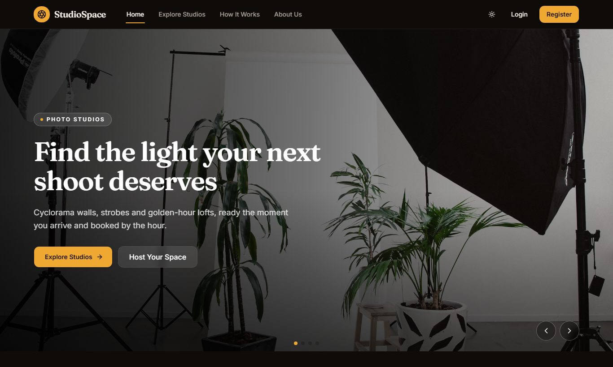
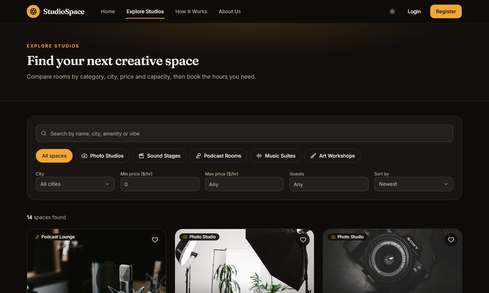
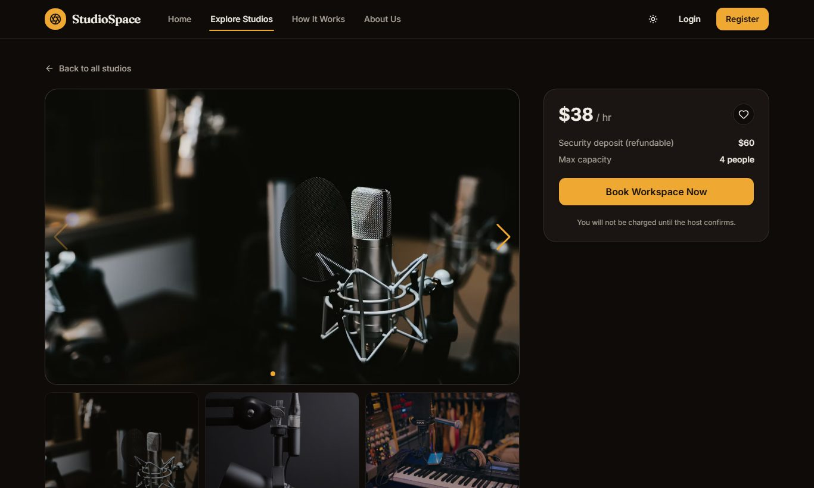
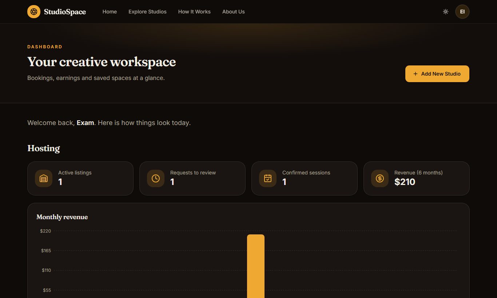
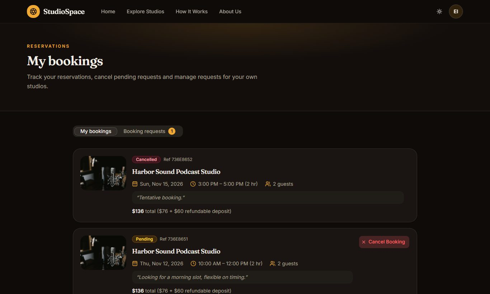
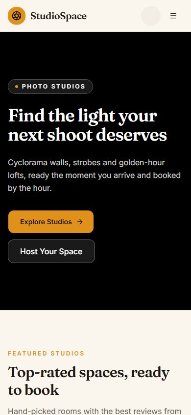
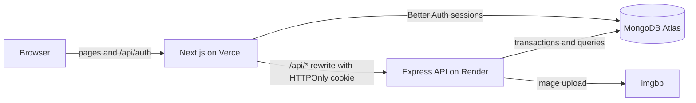

<a id="top"></a>

<div align="center">



<br />

<h1>🎬 StudioSpace</h1>

<p>
  <a href="https://studiospace-creators.vercel.app/"></a>
  &nbsp;
  <a href="https://github.com/SamaunRezvi/assignment_eight_s"></a>
  &nbsp;
  <a href="#about-the-project"></a>
  &nbsp;
  <a href="#key-features"></a>
  &nbsp;
  <a href="#tech-stack"></a>
  &nbsp;
  <a href="#getting-started"></a>
</p>

<h2>Rent the room. Make the work.</h2>

<p>Discover creative spaces. Compare by the hour. Book without the back-and-forth.</p>

<p><sub><strong>PHOTO STUDIOS</strong> &nbsp; · &nbsp; <strong>FILM STAGES</strong> &nbsp; · &nbsp; <strong>PODCAST LOUNGES</strong> &nbsp; · &nbsp; <strong>MUSIC SUITES</strong> &nbsp; · &nbsp; <strong>WORKSHOPS</strong></sub></p>

</div>

<br />

## About the Project

**StudioSpace is a peer-to-peer marketplace where filmmakers, photographers, podcasters, musicians and artists rent creative spaces by the hour.**

Hosts list the rooms they have built: cyclorama walls, soundproofed stages, podcast lounges, recording suites and art
workshops. Creators search and filter those spaces, see transparent pricing, pick the exact hours they need and send a
booking request. Hosts confirm sessions from their own dashboard, and confirmed slots are protected so two bookings can
never overlap.

This repository is the **Next.js client**. It talks to a separate [Express API](https://github.com/SamaunRezvi/assignment_eight_s)
backed by MongoDB Atlas, and uses Better Auth for email and Google sign in.

## Key Features

1. **Discover and filter.** Search by keyword, then narrow by category, city, price range and capacity. Sorting, pagination and filters live in the URL, so every search can be shared.
2. **A home page that sells the experience.** An autoplaying Swiper hero, six top-rated featured studios fetched from the database, category shortcuts that preselect filters, a booking walkthrough and host guarantees.
3. **Secure authentication.** Email and password with enforced rules (uppercase, lowercase, six characters) or Google sign in. The session is mirrored into an **HTTPOnly JWT cookie** that the API verifies; unauthorised requests receive `401`.
4. **Full studio management.** Add, update and delete listings with cover and gallery images (hosted through imgbb), amenity tags, ownership checks and confirmation modals before anything is deleted.
5. **Bookings that cannot collide.** Live price breakdown, availability hints and a transactional overlap check against confirmed slots. Hosts confirm, decline or complete requests; guests can cancel pending ones.
6. **Receipts, wishlist and reviews.** Download a **PDF receipt** for confirmed bookings, save favourites with a heart, and leave star reviews that update each studio's rating.
7. **Dashboard.** A host and guest overview with booking status counts, spend and a monthly revenue chart.
8. **Light and dark themes**, responsive layouts, branded skeleton loaders, friendly empty states, a custom 404 and toast feedback for every action.

## Screenshots

<table>
<tr>
<td width="50%"><br /><sub><strong>Home</strong> · hero slider, featured studios and categories</sub></td>
<td width="50%"><br /><sub><strong>Explore</strong> · search, category chips and filters</sub></td>
</tr>
<tr>
<td width="50%"><br /><sub><strong>Studio details</strong> · gallery, amenities, host and booking panel</sub></td>
<td width="50%"><br /><sub><strong>Dashboard</strong> · hosting stats and monthly revenue</sub></td>
</tr>
<tr>
<td width="50%"><br /><sub><strong>My bookings</strong> · status badges, cancel and receipts</sub></td>
<td width="50%" align="center"><br /><sub><strong>Mobile</strong> · responsive from the first pixel</sub></td>
</tr>
</table>

## The Experience

<table>
<tr>
<td width="33%" valign="top">
<sub>01 / DISCOVER</sub>
<h3>Find the right room.</h3>
<p>Browse five studio categories, filter by city, price and capacity, and read honest reviews from working creators.</p>
</td>
<td width="34%" valign="top">
<sub>02 / BOOK</sub>
<h3>Pick your hours.</h3>
<p>Choose a date and time, see the full price with the refundable deposit, and send a request in one step. Taken slots are shown before you commit.</p>
</td>
<td width="33%" valign="top">
<sub>03 / HOST</sub>
<h3>Turn space into income.</h3>
<p>List a studio in minutes, review requests, confirm sessions and follow earnings from your dashboard.</p>
</td>
</tr>
</table>

### Challenge requirements

| Challenge                         | How it is implemented                                                                                                                                  |
| :-------------------------------- | :----------------------------------------------------------------------------------------------------------------------------------------------------- |
| JWT in HTTPOnly cookies           | Better Auth issues a short-lived HS256 JWT in an `HttpOnly; Secure; SameSite=Lax` cookie. The API rejects mutations without it with `401 Unauthorized`. |
| Double-booking prevention         | A MongoDB transaction checks time overlap against **Confirmed** bookings before saving or confirming, and returns a clear collision message.           |
| Theme customisation               | A header toggle switches the whole interface between light and dark and remembers your choice.                                                         |
| Optional: PDF invoice             | Confirmed and completed bookings offer a downloadable PDF receipt.                                                                                     |
| Optional: Saved studios wishlist  | A heart icon on every studio card saves favourites to MongoDB for signed-in users.                                                                     |

### Small details that matter

| Detail                | What you see                                                                                          |
| :-------------------- | :---------------------------------------------------------------------------------------------------- |
| Active navigation     | A sliding amber indicator follows the page you are on.                                                |
| Account menu          | Hover or click your avatar for Dashboard, Add New Studio, My Listings, My Bookings and Logout.        |
| Password feedback     | A live checklist ticks off each password rule as you type, with a show/hide button.                   |
| Safe image handling   | Broken image links fall back to a branded placeholder instead of an empty box.                        |
| Feedback and recovery | Skeletons, retry buttons, empty states with calls to action, toast messages and a custom 404 page.    |
| Reload safe           | Reloading any route works, and a signed-in user is never bounced to login from a private page.        |

<br />

## Tech Stack

<div align="center">


</div>

<br />

| Technology                  | Responsibility                                                   |
| :-------------------------- | :--------------------------------------------------------------- |
| Next.js 16 (App Router)     | Pages, routing, server rendering and the API rewrite proxy       |
| React 19 + TypeScript       | Components, forms and typed data                                 |
| Tailwind CSS 4 + shadcn/ui  | Design tokens, theming and accessible UI primitives              |
| Better Auth + MongoDB       | Email and Google sign in, sessions and the HTTPOnly API token    |
| TanStack Query              | Data fetching, caching and optimistic wishlist updates           |
| React Hook Form + Zod       | Form handling and validation shared with the API                 |
| Swiper, Recharts, Motion    | Hero and gallery sliders, revenue chart, animated nav indicator  |
| Sonner                      | Toast notifications                                              |
| Express 5 API on Render     | Business rules, bookings, invoices ([repository](https://github.com/SamaunRezvi/assignment_eight_s)) |
| MongoDB Atlas               | Database                                                         |
| Vercel                      | Application hosting                                              |

### How the pieces fit



<br />

## Test Credentials

Use these demo accounts to explore without registering. You can also create your own account or continue with Google.

| Role                          | Email                         | Password       |
| :---------------------------- | :---------------------------- | :------------- |
| Examiner (host and guest)     | `examiner@studiospace.test`   | `Examiner123`  |
| Second user (host and guest)  | `host.demo@studiospace.test`  | `Hostdemo123`  |

The examiner account already owns a studio, has bookings in every status (Pending, Confirmed, Completed, Cancelled),
incoming booking requests and saved studios, so every page has something to show.

### How the two accounts work together

There is no separate "host" or "guest" account type. Every user can list studios (acting as a **host**) and book other
people's studios (acting as a **guest**), and the app shows the right tools for whichever role applies to a booking.

| Account                      | Hosts                          | Books                         |
| :--------------------------- | :----------------------------- | :---------------------------- |
| `examiner@studiospace.test`  | Skyline Rooftop Photo Loft     | Harbor Sound Podcast Studio   |
| `host.demo@studiospace.test` | Harbor Sound Podcast Studio    | Skyline Rooftop Photo Loft    |

To see a full booking from both sides, open the site in two browsers (or one normal and one private window):

1. As the guest, open a studio owned by the other account and choose **Book Workspace Now**. The request starts as **Pending**.
2. As the host, open **My Bookings** then **Booking requests**, and **Confirm** it. Confirmed slots can no longer be booked by anyone else.
3. Back as the guest, try an overlapping time on the same studio. The request is rejected with a clear "already booked" message.
4. The guest can download a PDF receipt for confirmed bookings, and the host can mark a finished session as **Completed**.

<br />

## Getting Started

Requirements: Node.js 20.9 or newer, a MongoDB Atlas cluster (replica set) and the
[API](https://github.com/SamaunRezvi/assignment_eight_s) running locally.

```bash
git clone https://github.com/SamaunRezvi/assignment_eight_c.git
cd assignment_eight_c
npm install
cp .env.example .env.local
npm run dev
```

Fill `.env.local` with your own values, then open `http://localhost:3000`.

| Variable                                      | Purpose                                                                    |
| :-------------------------------------------- | :------------------------------------------------------------------------- |
| `BETTER_AUTH_URL`                             | Public URL of this app                                                     |
| `BETTER_AUTH_SECRET`                          | Random string of at least 32 characters                                    |
| `MONGODB_URI`, `MONGODB_DB`                   | Database shared with the API                                               |
| `GOOGLE_CLIENT_ID`, `GOOGLE_CLIENT_SECRET`    | Google OAuth (redirect URI: `<BETTER_AUTH_URL>/api/auth/callback/google`)  |
| `API_URL`                                     | Base URL of the Express API; `/api/*` is proxied there                     |
| `API_JWT_SECRET`                              | Must equal the API's `JWT_SECRET`                                          |
| `AUTH_COOKIE_NAME`                            | Name of the HTTPOnly token cookie (`studiospace_token`)                    |

Seed demo studios from the API repository with `npm run seed`.

| Command         | Description                  |
| :-------------- | :--------------------------- |
| `npm run dev`   | Start the development server |
| `npm run build` | Create a production build    |
| `npm run start` | Serve the production build   |
| `npm run lint`  | Check the code with ESLint   |
| `npm run typecheck` | Generate route types and type-check |

### Security notes

- Secrets live only in environment variables; `.env*` files are git-ignored and only `.env.example` is committed.
- The API token cookie is `HttpOnly`, so page scripts can never read it, and the API checks the request origin to block cross-site writes.
- Post-login redirects accept only same-site paths, and every form is validated on the client and again on the API.

<br />

## Project Links

| Resource          | Link                                                                         |
| :---------------- | :--------------------------------------------------------------------------- |
| Live application  | [studiospace-creators.vercel.app](https://studiospace-creators.vercel.app/)  |
| Client repository | [SamaunRezvi/assignment_eight_c](https://github.com/SamaunRezvi/assignment_eight_c) |
| API repository    | [SamaunRezvi/assignment_eight_s](https://github.com/SamaunRezvi/assignment_eight_s) |

## Project Note

Built as a Programming Hero learning assignment. Studio photos come from Unsplash, and listings, hosts and prices in the
demo data are fictional.

**Good to know:** The live site runs on free hosting tiers. If the API has been idle for a while it can take up to a
minute to wake up, so the first request may feel slow. It works normally right after, and no data is lost.

<br />

<div align="center">

<p><strong>STUDIOSPACE</strong></p>
<p><sub>RENT THE ROOM · MAKE THE WORK</sub></p>

<a href="https://studiospace-creators.vercel.app/">Explore StudioSpace ↗</a> &nbsp; · &nbsp; <a href="#top">Back to top ↑</a>

</div>
